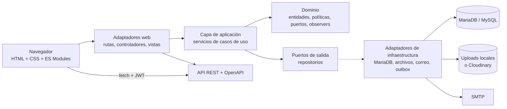

# Bibliotech

**Bibliotech** es una plataforma de gestión de material educativo y aulas virtuales. Permite administrar usuarios y roles, organizar carreras y materias, publicar y compartir material educativo, moderar contenido sugerido, suscribir alumnos, registrar progreso de lectura y auditar las acciones críticas del sistema.

El proyecto está construido con una arquitectura hexagonal: el dominio y los casos de uso se mantienen separados de Express, de MariaDB y del frontend. La persistencia se resuelve mediante el patrón Repository sobre interfaces (puertos), con adaptadores concretos para MariaDB. El frontend es Vanilla JavaScript con ES Modules y Web Components, sin framework y sin paso de build.

**Demo:** [https://bibliotech-tawny.vercel.app](https://bibliotech-tawny.vercel.app)

---

## Tabla de contenidos

- [Descripción general](#descripción-general)
- [Características principales](#características-principales)
- [Roles y permisos](#roles-y-permisos)
- [Tecnologías](#tecnologías)
- [Arquitectura](#arquitectura)
- [Estructura del repositorio](#estructura-del-repositorio)
- [Rutas de la aplicación](#rutas-de-la-aplicación)
  - [Rutas del frontend](#rutas-del-frontend)
  - [API REST](#api-rest)
  - [Salud y documentación](#salud-y-documentación)
- [Documentación y diagramas](#documentación-y-diagramas)
- [Puesta en marcha local](#puesta-en-marcha-local)
- [Pruebas y calidad](#pruebas-y-calidad)
- [Despliegue](#despliegue)
- [Operación y observabilidad](#operación-y-observabilidad)
- [Seguridad](#seguridad)
- [Estado del proyecto](#estado-del-proyecto)
- [Licencia](#licencia)

---

## Descripción general

Bibliotech cubre el ciclo completo del material educativo:

1. Un alumno o profesor sube un archivo o registra un enlace.
2. El material se valida, se deduplica por hash y se asocia a una o más materias.
3. Un profesor lo aprueba o rechaza para cada materia; el superadministrador puede gestionar asociaciones y cargas masivas.
4. Los alumnos suscriptos reciben novedades, consultan el catálogo, guardan favoritos, registran lecturas y acumulan progreso.
5. Las acciones críticas quedan en auditoría y los eventos de correo/notificación se procesan mediante un outbox.

La aplicación expone una API REST documentada con OpenAPI, un frontend estático sin build, documentación técnica pública con Redoc y Mermaid, y herramientas de operación (health checks, métricas, backups y retención).

### Alcance funcional

| Área | Incluye |
| --- | --- |
| Identidad | Registro, verificación de cuenta, login, logout, recuperación y cambio de contraseña, JWT, roles y bans. |
| Academia | Carreras, años de carrera, materias, profesores titulares y solicitudes de asociación. |
| Materiales | Archivos y enlaces, portadas, hash SHA-256, múltiples materias, favoritos, aprobación, rechazo, cancelación y carga masiva. |
| Alumnos | Suscripciones a materias, seguimiento de autores, baneo por materia, backlog y progreso de lectura. |
| Gamificación | XP, rangos, insignias, rachas y perfil público. |
| Notificaciones | Bandeja de notificaciones y envío de correo transaccional mediante outbox. |
| Auditoría | Registro de acciones críticas, consulta por superadministrador y retención configurable. |
| Operación | `/healthz`, `/readyz`, métricas Prometheus, logs JSON, backups y restauración. |

---

## Características principales

- **Autenticación completa:** JWT de corta duración, bcrypt, verificación por correo, recuperación de contraseña y cookie `HttpOnly` para la visualización de archivos.
- **Gestión académica:** carreras, años, materias y asignación de profesores con confirmación del superadministrador.
- **Catálogo global:** búsqueda transversal, filtros por materia, carrera, año, etiquetas y autor.
- **Material educativo:** carga de archivos o enlaces, detección de duplicados por hash, portadas, asociación a múltiples materias y descarga segura.
- **Moderación:** aprobación y rechazo por materia, cancelación de subidas pendientes, eliminación global y baneo de alumnos.
- **Suscripciones y engagement:** alumnos suscriptos a materias, seguimiento de autores, favoritos, backlog y progreso de lectura.
- **Gamificación:** XP, rangos, insignias, rachas y perfil público con estadísticas.
- **Notificaciones y correo:** bandeja interna, envío SMTP y outbox con reintentos, backoff y cola de mensajes muertos.
- **Auditoría:** registro de operaciones críticas con retención y archivado.
- **Internacionalización:** mensajes de interfaz y validación en español e inglés.
- **Documentación pública:** Redoc, especificación OpenAPI, guía técnica, diagramas Mermaid/PDF y ADRs.
- **Operación:** health checks, readiness, métricas, cierre ordenado, backups y restauración verificable.

---

## Roles y permisos

| Rol | Capacidades principales |
| --- | --- |
| **Visitante** | Consulta el catálogo global, materias, perfiles públicos y material aprobado. Accede a la documentación de la API. |
| **Alumno** | Se registra y verifica su cuenta, se suscribe a materias, sigue autores, gestiona favoritos, backlog y lecturas, sugiere material (máximo 3 pendientes) y acumula XP. |
| **Profesor** | Administra el contenido de sus materias, revisa sugerencias, aprueba o rechaza material por materia, asocia materiales y modera alumnos. |
| **Superadministrador** | Crea profesores, carreras y materias; confirma asociaciones de profesores; gestiona usuarios, etiquetas, cargas masivas, auditoría y eliminación global de material. |

La autorización se aplica en el backend con middleware de autenticación y roles. Las reglas de negocio específicas del material viven en políticas de dominio y servicios de aplicación.

---

## Tecnologías

| Capa | Tecnologías |
| --- | --- |
| **Backend** | Node.js 24, Express 5, CommonJS, `mysql2`, JWT, bcrypt, Multer, Nodemailer, Cloudinary opcional. |
| **Frontend** | JavaScript Vanilla, ES Modules (`.mjs`), Web Components, CSS modular con variables, W3.CSS, i18n propio `es`/`en`. Sin framework ni bundler. |
| **Base de datos** | MariaDB / MySQL, InnoDB, `utf8mb4`, 21 tablas, 30 claves foráneas y migraciones SQL versionadas. |
| **Pruebas** | `node:test`, runner headless propio, pruebas de contrato, presupuesto de rendimiento, ESLint, Prettier y validación OpenAPI. |
| **Infraestructura** | Vercel serverless para la API, frontend estático, SMTP, almacenamiento local o Cloudinary, Prometheus y Grafana. |
| **Documentación** | OpenAPI 3, Redoc, Mermaid, PDFs y ADRs. |

---

## Arquitectura

Bibliotech sigue una arquitectura hexagonal con adaptadores de entrada y salida:



### Capas

- **Dominio:** entidades, políticas de material, puertos de repositorio y el patrón Observer.
- **Aplicación:** servicios de autenticación, usuarios, carreras, materias, materiales, suscripciones, notificaciones, auditoría, etiquetas y gamificación. `MaterialService` actúa como fachada y delega en servicios especializados de carga, moderación, asociación, catálogo, favoritos y acceso.
- **Infraestructura:** repositorios MariaDB, pool `mysql2`, almacenamiento local/Cloudinary, correo, workers de outbox y contenedor de dependencias.
- **Adaptadores de entrada:** rutas y controladores Express, middleware de autenticación, idioma, errores y rate limiting; frontend con controladores de página y Web Components.
- **Transacciones:** los casos de uso multi-tabla usan transacciones por caso de uso con `AsyncLocalStorage`.

### Flujo típico de una petición

1. El navegador envía una petición a `/api/*` con `Authorization: Bearer <JWT>` y el idioma.
2. Express aplica CORS, parsers, contexto de request, idioma, autenticación y rate limiting.
3. El controlador valida la entrada y llama al servicio de aplicación.
4. El servicio aplica reglas de dominio y usa puertos de repositorio.
5. El adaptador MariaDB ejecuta SQL dentro de la transacción activa.
6. La respuesta se normaliza con DTOs y un `requestId`; los errores usan el formato común de la API.

### Modelo de datos

El esquema relacional incluye, entre otras, las tablas `roles`, `ranks`, `users`, `careers`, `career_years`, `subjects`, `subject_professors`, `categories`, `materials`, `material_subjects`, `subscriptions`, `user_subscriptions`, `material_favorites`, `material_reads`, `reading_backlog`, `reading_streaks`, `user_badges`, `notifications`, `audit_logs`, `thematic_tags` y `schema_migrations`.

El detalle completo está en [`docs/database_diagram.txt`](docs/database_diagram.txt), [`docs/database_diagram.pdf`](docs/database_diagram.pdf) y en la guía pública `/api/documentation/db`.

### Patrones y decisiones relevantes

- **Repository / Ports & Adapters:** los servicios dependen de interfaces; los adaptadores MariaDB implementan los puertos.
- **Facade:** `MaterialService` mantiene un contrato estable sobre servicios más pequeños.
- **Observer:** las materias funcionan como sujetos observables y los alumnos como observadores.
- **Outbox:** correos, notificaciones y auditoría se procesan con reintentos y cola de mensajes muertos.
- **DTOs:** las respuestas de material se normalizan antes de salir de la aplicación.
- **Políticas de dominio:** reglas de estado, permisos y asociaciones de material.
- **ADR:** las decisiones están registradas en [`docs/adr/`](docs/adr/).

Las fases 0 a 4 del roadmap están implementadas. Los riesgos residuales y las oportunidades de mejora se documentan en [`docs/code_analysis.md`](docs/code_analysis.md) y [`docs/refactoring_roadmap.md`](docs/refactoring_roadmap.md).

---

## Estructura del repositorio

```text
bibliotech/
├── backend/
│   ├── application/
│   │   ├── dto/                  # DTOs de respuesta
│   │   └── services/             # Casos de uso y fachada de materiales
│   ├── config/                   # Entorno, DB, Multer, init.sql y migraciones
│   ├── controllers/              # Adaptadores HTTP
│   ├── domain/
│   │   ├── entities/             # Entidades de negocio
│   │   ├── observers/            # Patrón Observer
│   │   ├── policies/             # Reglas de dominio
│   │   └── ports/                # Interfaces de repositorio
│   ├── infrastructure/
│   │   ├── mail/                 # Correo y dispatcher
│   │   ├── repositories/         # Adaptadores MariaDB
│   │   └── workers/              # Outbox worker
│   ├── middleware/               # Auth, idioma, errores, request context
│   ├── routes/                   # API, vistas, documentación y salud
│   ├── scripts/                  # Migraciones, OpenAPI, backups, rendimiento
│   ├── tests/                    # Pruebas unitarias y de contrato
│   ├── utils/                    # Logs, métricas, hashes, respuestas
│   ├── validator/                # Validación multilingüe
│   └── server.js                 # Punto de entrada
├── frontend/
│   ├── css/                      # Sistema de diseño
│   ├── html/                     # Pantallas
│   └── js/
│       ├── components/           # Web Components
│       ├── frontControllers/     # Controladores de página
│       ├── i18n/                 # LanguageManager y locales
│       ├── services/             # apiService
│       ├── tests/                # Suite de integración headless
│       └── utils/                # DOM, sesión y validación
├── docs/
│   ├── adr/                      # Architecture Decision Records
│   ├── diagrams/                 # Diagramas Mermaid y PDF
│   ├── openapi.yaml              # Contrato OpenAPI canónico
│   ├── openapi.json              # Especificación generada
│   └── *.md                      # Arquitectura, análisis, operación y fases
├── ops/
│   ├── grafana/                  # Dashboard
│   ├── logrotate/                # Rotación de logs
│   └── prometheus/               # Alertas
├── .github/workflows/ci.yml      # Pipeline de integración continua
└── package.json
```

---

## Rutas de la aplicación

La aplicación expone **104 operaciones HTTP** sobre **94 rutas** en la especificación OpenAPI, además de las rutas de navegación del frontend. La fuente contractual completa es [`docs/openapi.yaml`](docs/openapi.yaml); la referencia interactiva está en `/api/documentation`.

**Acceso:** `Público` no requiere sesión; `JWT` requiere token válido; `Opcional` acepta usuarios anónimos o autenticados; `Superadmin` y `Profesor` requieren el rol indicado. La autorización fina puede depender del recurso.

### Rutas del frontend

| Ruta | Pantalla / comportamiento | Acceso |
| --- | --- | --- |
| `/`, `/catalogo` | Catálogo global de material aprobado | Público |
| `/materias` | Listado de materias | Público |
| `/materia/:id` | Detalle de materia y materiales | Público |
| `/autor/:id` | Perfil y publicaciones de un autor | Público |
| `/perfil`, `/perfil/:id` | Perfil propio o público | Público/JWT |
| `/login` | Inicio de sesión | Público |
| `/register` | Registro de alumno | Público |
| `/forgot-password` | Solicitud de recuperación | Público |
| `/reset-password` | Redirección a `/forgot-password` | Público |
| `/recuperar` | Redirección a `/forgot-password` | Público |
| `/reset-password/:token` | Redirección al formulario de restablecimiento | Público |
| `/restablecer-password/:token` | Formulario de nueva contraseña | Público |
| `/activar-cuenta/:token` | Activa la cuenta y redirige al login | Público |
| `/confirmar-cuenta`, `/verify-account` | Redirección al login | Público |
| `/mi-contenido` | Contenido y sugerencias del usuario | JWT |
| `/alumno` | Dashboard de alumno | Alumno |
| `/profesor` | Dashboard de profesor | Profesor |
| `/admin` | Dashboard de superadministrador | Superadmin |
| `/favoritos` | Favoritos del usuario | JWT |
| `/tests` | Runner de pruebas en navegador | Desarrollo |
| `*` sin extensión | Catálogo con respuesta 404 | Público |
| `*` con extensión | Recurso estático no encontrado | Público |

### API REST

#### Autenticación, cuentas y usuarios

| Método | Ruta | Acceso | Descripción |
| --- | --- | --- | --- |
| `POST` | `/api/auth/register` | Público | Registra un alumno. |
| `POST` | `/api/auth/verify-account` | Público | Verifica una cuenta con código. |
| `GET` | `/api/auth/verify-account` | Público | Verifica una cuenta con código por query. |
| `POST` | `/api/auth/activate` | Público | Activa una cuenta con token. |
| `GET` | `/api/auth/activate/{token}` | Público | Activa una cuenta desde el enlace del correo. |
| `POST` | `/api/auth/resend-verification` | Público | Reenvía el código de verificación. |
| `POST` | `/api/auth/login` | Público | Inicia sesión y emite el JWT. |
| `POST` | `/api/auth/logout` | Público | Cierra la sesión y elimina la cookie de archivos. |
| `POST` | `/api/auth/forgot-password` | Público | Solicita el restablecimiento de contraseña. |
| `GET` | `/api/auth/reset-password/{token}/validate` | Público | Valida un token de restablecimiento. |
| `POST` | `/api/auth/reset-password` | Público | Restablece la contraseña con token. |
| `GET` | `/api/auth/roles` | Público | Lista los roles disponibles. |
| `GET` | `/api/auth/me` | JWT | Devuelve el usuario autenticado. |
| `PUT` | `/api/auth/password` | JWT | Cambia la contraseña del usuario autenticado. |
| `POST` | `/api/auth/professors` | Superadmin | Crea una cuenta de profesor. |
| `GET` | `/api/auth/users` | Superadmin | Lista usuarios con filtros. |
| `PUT` | `/api/auth/users/{id}/ban` | Superadmin | Banea a un usuario. |
| `PUT` | `/api/auth/users/{id}/unban` | Superadmin | Desbanea a un usuario. |
| `PUT` | `/api/auth/users/{id}/role` | Superadmin | Cambia el rol de un usuario. |
| `DELETE` | `/api/auth/users/{id}` | Superadmin | Da de baja a un usuario. |

#### Materiales y archivos

| Método | Ruta | Acceso | Descripción |
| --- | --- | --- | --- |
| `GET` | `/api/materials/global` | Opcional | Catálogo global de materiales aprobados. |
| `GET` | `/api/materials/filters` | Opcional | Opciones de filtro disponibles. |
| `GET` | `/api/materials/mine` | JWT | Materiales subidos por el usuario autenticado. |
| `POST` | `/api/materials/upload` | JWT | Sube un archivo o registra un enlace. |
| `GET` | `/api/materials/author/{id}` | Opcional | Materiales publicados por un autor. |
| `GET` | `/api/materials/pending` | JWT | Sugerencias pendientes del usuario. |
| `GET` | `/api/materials/pending-review` | Profesor/Superadmin | Bandeja de revisión del profesor. |
| `POST` | `/api/materials/batch` | Superadmin | Carga masiva de materiales. |
| `POST` | `/api/materials/{id}/favorite` | JWT | Alterna el material en favoritos. |
| `GET` | `/api/materials/favorites/mine` | JWT | Lista los favoritos del usuario. |
| `PUT` | `/api/materials/{id}` | JWT | Actualiza un material. |
| `DELETE` | `/api/materials/{id}` | Superadmin | Elimina un material globalmente. |
| `DELETE` | `/api/materials/{id}/subjects/{subjectId}` | JWT | Quita un material de una materia. |
| `GET` | `/api/materials/{id}/file` | Público/JWT | Sirve el archivo para visualización inline. |
| `GET` | `/api/materials/{id}/download` | Público/JWT | Descarga el archivo como adjunto. |

#### Moderación y asociaciones de material

| Método | Ruta | Acceso | Descripción |
| --- | --- | --- | --- |
| `POST` | `/api/materials/{id}/approve` | Profesor/Superadmin | Aprueba un material para una materia. |
| `POST` | `/api/materials/{id}/reject` | Profesor/Superadmin | Rechaza un material para una materia. |
| `POST` | `/api/materials/{id}/associate` | Profesor/Superadmin | Asocia un material a una o más materias del profesor. |
| `POST` | `/api/materials/{id}/cancel` | JWT | Cancela una subida pendiente y borra sus archivos. |

#### Perfil, lectura y engagement

| Método | Ruta | Acceso | Descripción |
| --- | --- | --- | --- |
| `GET` | `/api/profile/{id}` | Público | Perfil público de un usuario. |
| `PUT` | `/api/profile` | JWT | Actualiza el perfil propio. |
| `GET` | `/api/profile-pictures` | JWT | Lista los avatares disponibles. |
| `GET` | `/api/users/{id}/favorites` | JWT | Favoritos de un usuario. |
| `GET` | `/api/users/{id}/uploads` | Opcional | Subidas de un usuario. |
| `GET` | `/api/users/{id}/reads` | JWT | Lecturas de un usuario. |
| `GET` | `/api/users/{id}/backlog` | JWT | Pendientes de lectura de un usuario. |
| `GET` | `/api/reads` | JWT | Lista las lecturas propias. |
| `GET` | `/api/reads/{materialId}` | JWT | Obtiene el progreso de lectura. |
| `POST` | `/api/reads/{materialId}/toggle` | JWT | Marca o desmarca una lectura. |
| `PUT` | `/api/reads/{materialId}/progress` | JWT | Actualiza el progreso de lectura. |
| `GET` | `/api/backlog` | JWT | Lista los pendientes de lectura. |
| `POST` | `/api/backlog/{materialId}` | JWT | Agrega un material a pendientes. |
| `DELETE` | `/api/backlog/{materialId}` | JWT | Quita un material de pendientes. |
| `POST` | `/api/subscriptions/{userId}` | JWT | Sigue a un autor. |
| `DELETE` | `/api/subscriptions/{userId}` | JWT | Deja de seguir a un autor. |

#### Rachas y gamificación

| Método | Ruta | Acceso | Descripción |
| --- | --- | --- | --- |
| `GET` | `/api/streaks` | JWT | Consulta la racha de lectura. |
| `POST` | `/api/streaks/heartbeat` | JWT | Registra actividad de lectura. |
| `POST` | `/api/streaks/reset` | JWT | Reinicia la racha. |

#### Carreras y materias

| Método | Ruta | Acceso | Descripción |
| --- | --- | --- | --- |
| `GET` | `/api/careers` | Público | Lista carreras. |
| `POST` | `/api/careers` | Superadmin | Crea una carrera. |
| `GET` | `/api/careers/{id}` | Público | Obtiene una carrera. |
| `PUT` | `/api/careers/{id}` | Superadmin | Actualiza una carrera. |
| `POST` | `/api/careers/{id}/years` | Superadmin | Agrega un año a una carrera. |
| `PUT` | `/api/careers/years/{yearId}` | Superadmin | Actualiza un año. |
| `GET` | `/api/subjects` | Público | Lista materias. |
| `POST` | `/api/subjects` | Superadmin | Crea una materia. |
| `GET` | `/api/subjects/{id}` | Público | Obtiene una materia. |
| `PUT` | `/api/subjects/{id}` | Superadmin | Actualiza una materia. |
| `GET` | `/api/subjects/{id}/materials` | Público | Materiales de una materia. |
| `POST` | `/api/subjects/{id}/request-association` | Profesor | Solicita asociar una materia. |
| `POST` | `/api/subjects/{id}/confirm-association` | Superadmin | Confirma una asociación. |
| `POST` | `/api/subjects/{id}/reject-association` | Superadmin | Rechaza una asociación. |

#### Suscripciones

| Método | Ruta | Acceso | Descripción |
| --- | --- | --- | --- |
| `GET` | `/api/subscriptions/mine` | JWT | Lista las suscripciones propias. |
| `POST` | `/api/subscriptions/subscribe/{subjectId}` | JWT | Se suscribe a una materia. |
| `DELETE` | `/api/subscriptions/subscribe/{subjectId}` | JWT | Cancela la suscripción a una materia. |
| `GET` | `/api/subscriptions/subject/{subjectId}/observers` | Profesor/Superadmin | Lista observadores de una materia. |
| `POST` | `/api/subscriptions/ban/{alumnoId}/{subjectId}` | Profesor/Superadmin | Banea a un alumno de una materia. |

#### Notificaciones, auditoría y etiquetas

| Método | Ruta | Acceso | Descripción |
| --- | --- | --- | --- |
| `GET` | `/api/notifications` | JWT | Lista notificaciones. |
| `POST` | `/api/notifications/read-all` | JWT | Marca todas las notificaciones como leídas. |
| `POST` | `/api/notifications/{id}/read` | JWT | Marca una notificación como leída. |
| `GET` | `/api/audit` | Superadmin | Consulta la auditoría. |
| `GET` | `/api/audit/user/{id}` | Superadmin | Consulta la auditoría de un usuario. |
| `GET` | `/api/thematic-tags` | Público | Lista etiquetas temáticas. |
| `POST` | `/api/thematic-tags` | JWT | Crea una etiqueta temática. |
| `PUT` | `/api/thematic-tags/{id}/ban` | Superadmin | Banea una etiqueta. |
| `DELETE` | `/api/thematic-tags/{id}` | Superadmin | Elimina una etiqueta. |

### Salud y documentación

#### Salud y métricas

| Método | Ruta | Acceso | Descripción |
| --- | --- | --- | --- |
| `GET` | `/healthz` | Público | Comprueba que el proceso responde. |
| `GET` | `/readyz` | Público | Comprueba la disponibilidad de la base de datos. |
| `GET` | `/metrics` | Público/Token | Expone métricas Prometheus; en producción requiere `METRICS_TOKEN`. |

#### Documentación pública

| Método | Ruta | Acceso | Descripción |
| --- | --- | --- | --- |
| `GET` | `/api/docs` | Público | Índice de enlaces a la especificación OpenAPI. |
| `GET` | `/api/docs/openapi.yaml` | Público | Especificación OpenAPI en YAML. |
| `GET` | `/api/docs/openapi.json` | Público | Especificación OpenAPI en JSON. |
| `GET` | `/api/documentation` | Público | Referencia interactiva de la API con Redoc. |
| `GET` | `/api/documentation/overview` | Público | Guía técnica y de arquitectura. |
| `GET` | `/api/documentation/architecture` | Público | Arquitectura explicada. |
| `GET` | `/api/documentation/classes` | Público | Diagramas de clases. |
| `GET` | `/api/documentation/sequences` | Público | Diagramas de secuencia. |
| `GET` | `/api/documentation/db` | Público | Diagrama y diccionario de base de datos. |
| `GET` | `/api/documentation/openapi` | Público | Instrucciones para importar OpenAPI. |
| `GET` | `/api/documentation/diagrams` | Público | Índice de diagramas Mermaid y PDF. |
| `GET` | `/api/documentation/diagrams/{file}` | Público | Diagrama Mermaid o PDF. |
| `GET` | `/api/documentation/assets/{file}` | Público | PDF de clases, secuencias o base de datos. |
| `GET` | `/api/documentation/adr` | Público | Índice de decisiones de arquitectura. |
| `GET` | `/api/documentation/adr/{file}` | Público | Architecture Decision Record. |

---

## Documentación y diagramas

### Documentación interactiva

Con el servidor en marcha:

- **Redoc:** `http://localhost:3000/api/documentation`
- **Guía técnica:** `http://localhost:3000/api/documentation/overview`
- **OpenAPI YAML:** `http://localhost:3000/api/docs/openapi.yaml`
- **OpenAPI JSON:** `http://localhost:3000/api/docs/openapi.json`

En producción, reemplazar el host por la URL del despliegue. La documentación y la especificación son públicas y no requieren JWT.

La especificación puede importarse en Postman, Insomnia, Swagger Editor o cualquier cliente compatible con OpenAPI 3. La fuente canónica es [`docs/openapi.yaml`](docs/openapi.yaml); [`docs/openapi.json`](docs/openapi.json) se genera desde ella.

### Diagramas de arquitectura

Los fuentes Mermaid y los PDF renderizados están en [`docs/diagrams/`](docs/diagrams/):

| Diagrama | Fuente | PDF |
| --- | --- | --- |
| Contexto del sistema | [`01_system_context.mmd`](docs/diagrams/01_system_context.mmd) | [`01_system_context.pdf`](docs/diagrams/01_system_context.pdf) |
| Capas y dependencias del backend | [`02_backend_architecture.mmd`](docs/diagrams/02_backend_architecture.mmd) | [`02_backend_architecture.pdf`](docs/diagrams/02_backend_architecture.pdf) |
| Topología de despliegue | [`03_deployment.mmd`](docs/diagrams/03_deployment.mmd) | [`03_deployment.pdf`](docs/diagrams/03_deployment.pdf) |
| Pipeline de una petición HTTP | [`04_request_pipeline.mmd`](docs/diagrams/04_request_pipeline.mmd) | [`04_request_pipeline.pdf`](docs/diagrams/04_request_pipeline.pdf) |
| Ciclo de vida del material | [`05_material_lifecycle.mmd`](docs/diagrams/05_material_lifecycle.mmd) | [`05_material_lifecycle.pdf`](docs/diagrams/05_material_lifecycle.pdf) |
| Autenticación y estados de cuenta | [`06_auth_flow.mmd`](docs/diagrams/06_auth_flow.mmd) | [`06_auth_flow.pdf`](docs/diagrams/06_auth_flow.pdf) |
| Lectura y gamificación | [`07_gamification_flow.mmd`](docs/diagrams/07_gamification_flow.mmd) | [`07_gamification_flow.pdf`](docs/diagrams/07_gamification_flow.pdf) |
| Rutas calientes de base de datos | [`08_database_hotspots.mmd`](docs/diagrams/08_database_hotspots.mmd) | [`08_database_hotspots.pdf`](docs/diagrams/08_database_hotspots.pdf) |
| Flujo de datos extremo a extremo | [`09_data_flow.mmd`](docs/diagrams/09_data_flow.mmd) | [`09_data_flow.pdf`](docs/diagrams/09_data_flow.pdf) |
| Arquitectura objetivo | [`10_target_architecture.mmd`](docs/diagrams/10_target_architecture.mmd) | [`10_target_architecture.pdf`](docs/diagrams/10_target_architecture.pdf) |

También están disponibles los diagramas detallados existentes:

| Documento | Contenido |
| --- | --- |
| [`docs/routes.txt`](docs/routes.txt) / [`docs/routes.pdf`](docs/routes.pdf) | Inventario completo de rutas, entradas, salidas y efectos. |
| [`docs/class_diagram.txt`](docs/class_diagram.txt) / [`docs/class_diagram.pdf`](docs/class_diagram.pdf) | Modelo de clases y componentes. |
| [`docs/database_diagram.txt`](docs/database_diagram.txt) / [`docs/database_diagram.pdf`](docs/database_diagram.pdf) | Modelo entidad-relación y diccionario de datos. |
| [`docs/professor_sequence_diagrams.txt`](docs/professor_sequence_diagrams.txt) / [`docs/professor_sequence_diagrams.pdf`](docs/professor_sequence_diagrams.pdf) | Secuencias de los flujos principales del profesor. |

### Documentos técnicos

| Documento | Contenido |
| --- | --- |
| [`docs/README.md`](docs/README.md) | Índice general de la documentación y evaluación. |
| [`docs/architecture.md`](docs/architecture.md) | Arquitectura, capas, flujos y topología. |
| [`docs/code_analysis.md`](docs/code_analysis.md) | Hallazgos de seguridad, correctitud, diseño y mantenibilidad. |
| [`docs/database_performance.md`](docs/database_performance.md) | Índices, consultas y rendimiento de MariaDB. |
| [`docs/refactoring_roadmap.md`](docs/refactoring_roadmap.md) | Fases, dependencias y criterios de aceptación. |
| [`docs/operations_runbook.md`](docs/operations_runbook.md) | Backups, restauración, retención y operación. |
| [`docs/phase0_acceptance.md`](docs/phase0_acceptance.md) a [`docs/phase4_acceptance.md`](docs/phase4_acceptance.md) | Evidencia de implementación por fase. |
| [`docs/adr/`](docs/adr/) | Decisiones de arquitectura aceptadas. |

---

## Puesta en marcha local

### Requisitos

- Node.js 24 o superior.
- npm.
- MariaDB 10.6+ o MySQL 8+.
- `mysqldump` y `mysql` para las tareas de backup/restauración.
- Opcional: cuenta de Cloudinary y credenciales SMTP para probar almacenamiento en la nube y correo real.

### 1. Instalar dependencias

```bash
git clone <url-del-repositorio> bibliotech
cd bibliotech/backend
npm ci
```

### 2. Crear la base de datos

El esquema base es no destructivo y crea la base `bibliotech` si no existe:

```bash
mysql -u root -p < backend/config/init.sql
```

Para una base existente, aplicar las migraciones versionadas:

```bash
cd backend
npm run db:migrate
```

Para un entorno local desde cero con datos demo:

```bash
mysql -u root -p < backend/config/reset_dev.sql
```

> `reset_dev.sql` es destructivo y carga cuentas de prueba. Nunca debe ejecutarse en producción. `seed_dev.sql` tampoco debe cargarse en producción.

### 3. Configurar variables de entorno

```bash
cd backend
cp .env.example .env
```

Editar `backend/.env` como mínimo con:

```dotenv
NODE_ENV=development
PORT=3000
APP_URL=http://localhost:3000

DB_HOST=localhost
DB_USER=bibliotech
DB_PASS=bibliotech
DB_NAME=bibliotech

JWT_SECRET=<secreto-de-al-menos-32-caracteres>
CORS_ORIGINS=http://localhost:3000,http://127.0.0.1:3000

FILES_MODE=local
```

En producción también son obligatorios `CORS_ORIGINS` sin comodines, `JWT_SECRET` fuerte, `EXPOSE_DEV_TOKENS=false` y, si se habilitan métricas, `METRICS_TOKEN`.

### 4. Iniciar el servidor

```bash
cd backend
npm start
```

Abrir `http://localhost:3000`. El mismo proceso sirve la API, la documentación y el frontend estático. Para desarrollo con recarga automática:

```bash
npm run dev
```

### Credenciales demo

Disponibles únicamente después de cargar `reset_dev.sql` o `seed_dev.sql`:

| Rol | Email | Contraseña |
| --- | --- | --- |
| Superadmin | `admin@bibliotech.edu` | `Admin123` |
| Profesor | `profesor@bibliotech.edu` | `Profesor123` |
| Alumno | `alumno@bibliotech.edu` | `Alumno123` |

---

## Pruebas y calidad

### Pipeline de CI

El workflow [`.github/workflows/ci.yml`](.github/workflows/ci.yml) usa Node.js 24 y ejecuta:

```bash
cd backend
npm ci
npm run test:ci
```

`test:ci` incluye:

- `lint`: ESLint.
- `format:check`: Prettier.
- `check:openapi`: cobertura de rutas y sincronización de la especificación.
- `test:coverage`: pruebas unitarias con umbrales de cobertura.
- `check:modules`: contrato de módulos del frontend.

### Suite de integración del frontend

La suite vive en `frontend/js/tests/` y se ejecuta contra un servidor en marcha. Puede correrse desde `http://localhost:3000/tests` o en modo headless:

```bash
cd backend
NODE_ENV=development EXPOSE_DEV_TOKENS=true FILES_MODE=local \
  AUTH_IP_RATE_LIMIT=10000 AUTH_ACCOUNT_RATE_LIMIT=10000 \
  AUTH_RECOVERY_RATE_LIMIT=10000 UPLOAD_RATE_LIMIT=10000 npm start
```

En otra terminal, desde la raíz:

```bash
node frontend/js/tests/runNode.mjs
```

Filtrar pruebas por nombre:

```bash
BT_TEST_FILTER='Test Seguridad' node frontend/js/tests/runNode.mjs
```

La suite cubre autenticación, materias, materiales, carreras, suscripciones, notificaciones, gamificación, refinamientos, administración, seguridad y SQL.

### Comandos individuales

```bash
cd backend

npm run lint            # ESLint
npm run format:check    # Verificación de formato
npm run check:openapi   # Contrato OpenAPI
npm run test:coverage   # Unitarias + cobertura
npm run check:modules   # Módulos del frontend
npm run test:contract   # Contrato contra una base real (opcional)
npm run test:perf       # Presupuesto de rendimiento (requiere DB)
```

Para regenerar la especificación OpenAPI después de cambiar rutas o esquemas:

```bash
cd backend
npm run generate:openapi
```

---

## Despliegue

### Arquitectura de producción

El despliegue de referencia usa **Vercel**:

- El frontend es estático y no requiere build.
- Express se ejecuta como función Node/serverless para la API, la documentación y los archivos servidos por la aplicación.
- MariaDB/MySQL es un servicio externo accesible desde las funciones.
- Los uploads deben usar Cloudinary en producción; el filesystem de una función serverless es efímero.
- El correo se envía por SMTP.
- La configuración del proyecto de Vercel vive en el dashboard; el repositorio no incluye `vercel.json`.

**URL de producción:** [https://bibliotech-tawny.vercel.app](https://bibliotech-tawny.vercel.app)

### Variables de entorno en producción

Configurar en el panel del proveedor (nunca en el repositorio):

| Variable | Valor / criterio |
| --- | --- |
| `NODE_ENV` | `production` |
| `APP_URL` | URL pública del despliegue. |
| `CORS_ORIGINS` | Origen exacto del frontend, separado por comas. No usar `*`. |
| `JWT_SECRET` | Secreto de al menos 32 caracteres y 128 bits de entropía. |
| `JWT_EXPIRES` | Duración del token; por defecto `2h`. |
| `DB_HOST`, `DB_USER`, `DB_PASS`, `DB_NAME` | Credenciales de la base administrada. |
| `DB_PORT` | Puerto de la base si no es `3306`. |
| `DB_SSL` | `true` si el proveedor exige TLS. |
| `DB_CONNECTION_LIMIT` | `1` en serverless. No incrementar sin revisar `max_connections`. |
| `FILES_MODE` | `cloud` en Vercel. `local` solo con disco persistente. |
| `CLOUDINARY_CLOUD_NAME`, `CLOUDINARY_API_KEY`, `CLOUDINARY_API_SECRET` | Credenciales de Cloudinary. |
| `EMAIL_USER_1`, `EMAIL_PASS_1` | Cuenta SMTP y contraseña de aplicación. |
| `EXPOSE_DEV_TOKENS` | `false`. |
| `METRICS_ENABLED` / `METRICS_TOKEN` | Si se habilitan métricas en producción, el token es obligatorio. |
| `EXPORT_SIMPLE_FOR_DEPLOY` | `true` para exportar directamente la app Express en Vercel. |
| `TRUST_PROXY` | `true` si hay un proxy inverso delante. |

### Despliegue en Vercel

1. Crear o configurar el proyecto de Vercel apuntando al repositorio.
2. Configurar Node.js 24 y la función Node con entrada en `backend/server.js`.
3. Definir `EXPORT_SIMPLE_FOR_DEPLOY=true` para que `server.js` exporte la app Express.
4. Cargar todas las variables de entorno de producción.
5. Aplicar las migraciones contra la base de producción antes de desplegar:

   ```bash
   cd backend
   npm run db:migrate
   ```

6. Desplegar la rama `main`.
7. Verificar:

   ```bash
   curl -fsS https://<dominio>/healthz
   curl -fsS https://<dominio>/readyz
   curl -fsS https://<dominio>/api/docs/openapi.json > /dev/null
   ```

8. Abrir `/api/documentation` y comprobar que Redoc carga la especificación.

Notas específicas de Vercel:

- El frontend usa módulos `.mjs` para evitar que Vercel transpile los ES Modules a CommonJS. No renombrar esos archivos ni introducir un bundler sin revisar el ADR [`0002-frontend-es-modules.md`](docs/adr/0002-frontend-es-modules.md).
- No hay build step para el frontend.
- Los archivos de `docs/` y `frontend/` se incluyen en el bundle de la función por el tracing de dependencias.
- Cada instancia serverless crea su propio pool. Mantener `DB_CONNECTION_LIMIT=1`, `DB_QUEUE_LIMIT` bajo y dimensionar `max_connections` para la cantidad máxima de instancias concurrentes.
- Si se usa almacenamiento local en un entorno serverless, los archivos se pierden entre invocaciones o despliegues. Usar `FILES_MODE=cloud`.
- El outbox worker corre dentro del proceso de la función; revisar los límites de ejecución y la configuración de `OUTBOX_*`.

### Despliegue en servidor propio

Requisitos: Node.js 24, MariaDB/MySQL, disco persistente para uploads y un proxy inverso con TLS.

```bash
git clone <url-del-repositorio> /srv/bibliotech
cd /srv/bibliotech/backend
npm ci --omit=dev
cp .env.example .env
# Editar .env con los valores de producción
npm run db:migrate
NODE_ENV=production npm start
```

Ejemplo de unidad systemd:

```ini
[Unit]
Description=Bibliotech
After=network.target mariadb.service

[Service]
Type=simple
User=bibliotech
WorkingDirectory=/srv/bibliotech/backend
EnvironmentFile=/srv/bibliotech/backend/.env
ExecStart=/usr/bin/node server.js
Restart=on-failure
RestartSec=5

[Install]
WantedBy=multi-user.target
```

Configurar Nginx, Caddy u otro proxy para terminar TLS y reenviar a `127.0.0.1:3000`. Si el proxy agrega `X-Forwarded-*`, activar `TRUST_PROXY=true`. Mantener `backend/uploads` en un volumen persistente y programar los backups.

### Checklist de producción

- [ ] Base creada y migraciones aplicadas.
- [ ] `JWT_SECRET` fuerte y único.
- [ ] `CORS_ORIGINS` restringido al dominio real.
- [ ] `EXPOSE_DEV_TOKENS=false`.
- [ ] `NODE_ENV=production`.
- [ ] `FILES_MODE=cloud` en serverless o disco persistente en VPS.
- [ ] SMTP y Cloudinary verificados.
- [ ] `METRICS_TOKEN` configurado si las métricas están habilitadas.
- [ ] Backups de base y uploads programados.
- [ ] `/healthz`, `/readyz` y `/api/documentation` verificados.
- [ ] Cuentas demo y `seed_dev.sql` fuera de producción.
- [ ] Logs y alertas conectados a Prometheus/Grafana.

---

## Operación y observabilidad

### Health checks

| Endpoint | Uso |
| --- | --- |
| `GET /healthz` | Liveness del proceso. Devuelve `503` durante el cierre ordenado. |
| `GET /readyz` | Readiness con `SELECT 1` a la base. Devuelve `503` si la base no responde. |
| `GET /metrics` | Métricas Prometheus de HTTP, DB, pool, correo, outbox y seguridad. |

En producción, `/metrics` requiere `Authorization: Bearer <METRICS_TOKEN>` cuando `METRICS_ENABLED=true`.

### Outbox y retención

Correos, notificaciones y auditoría se procesan mediante un outbox transaccional con worker, reintentos con backoff y cola de mensajes muertos. La entrega es al-menos-una-vez; notificaciones y auditoría son idempotentes.

Comandos de mantenimiento:

```bash
cd backend
npm run db:archive-audit
npm run db:prune-notifications
npm run db:prune-outbox
```

Configuración relevante: `OUTBOX_*`, `AUDIT_RETENTION_DAYS` y `NOTIFICATION_RETENTION_DAYS`.

### Backups y restauración

```bash
cd backend
npm run ops:backup
npm run ops:restore-drill -- /ruta/al/backup
npm run ops:restore -- /ruta/al/backup --yes
```

Los backups incluyen la base y los uploads locales. Los procedimientos, RPO/RTO y límites están en [`docs/operations_runbook.md`](docs/operations_runbook.md).

### Logs y métricas

- Logs estructurados JSON con `requestId`.
- `GET /metrics` expone métricas HTTP, DB, pool, correo, outbox y seguridad.
- Alertas de Prometheus en [`ops/prometheus/bibliotech-alerts.yml`](ops/prometheus/bibliotech-alerts.yml).
- Dashboard de Grafana en [`ops/grafana/bibliotech-dashboard.json`](ops/grafana/bibliotech-dashboard.json).
- Rotación de logs de referencia en [`ops/logrotate/bibliotech`](ops/logrotate/bibliotech).

El servidor maneja `SIGTERM`/`SIGINT` con cierre ordenado: detiene el outbox, deja de aceptar conexiones, cierra la base y fuerza la salida si se supera `SHUTDOWN_TIMEOUT_MS`.

---

## Seguridad

- Contraseñas con bcrypt y JWT de corta duración.
- Validación de entrada y mensajes localizados.
- Rate limiting por IP y por cuenta para autenticación, recuperación y uploads.
- Helmet con CSP, HSTS en producción y cabeceras de seguridad.
- CORS restringido por lista de orígenes; `*` no está permitido en producción.
- Verificación de cuenta y tokens temporales para recuperación de contraseña.
- Archivos validados por MIME, tamaño y hash SHA-256; los documentos aprobados se sirven mediante endpoints controlados.
- Cookie `HttpOnly` para el visor de archivos y soporte de peticiones `Range` para PDFs.
- Auditoría de acciones críticas y retención configurable.
- `EXPOSE_DEV_TOKENS=false` obligatorio en producción.
- Los archivos `.env` y las credenciales no se versionan.

Los hallazgos detallados y las mitigaciones pendientes están en [`docs/code_analysis.md`](docs/code_analysis.md).

---

## Estado del proyecto

- Arquitectura hexagonal con separación de dominio, aplicación, infraestructura y adaptadores.
- Fases 0 a 4 del roadmap implementadas; ver [`docs/phase0_acceptance.md`](docs/phase0_acceptance.md), [`docs/phase1_acceptance.md`](docs/phase1_acceptance.md), [`docs/phase2_acceptance.md`](docs/phase2_acceptance.md), [`docs/phase3_acceptance.md`](docs/phase3_acceptance.md) y [`docs/phase4_acceptance.md`](docs/phase4_acceptance.md).
- Frontend sin build, migrado a ES Modules (`.mjs`) y validado en CI.
- API documentada con OpenAPI 3, Redoc público y validación de cobertura en CI.
- Pruebas unitarias, de integración, de contrato, de rendimiento y de módulos.
- Observabilidad con health checks, métricas, logs JSON, outbox y backups.

Las oportunidades de mejora y los riesgos residuales se mantienen documentados en [`docs/README.md`](docs/README.md).

---

## Licencia

GNU General Public License v3.0.
