# Bibliotech — Architecture

**Assessment date:** 2026-10-30  
**Status:** describes the implementation as found in the repository, including deviations from the intended design.

---

## 1. Architectural Intent

The project describes itself as a **strict hexagonal architecture** in which:

- the domain is independent of the database, web framework, and UI;
- application services implement use cases;
- repositories are defined as domain ports and implemented by infrastructure adapters;
- input adapters (Express controllers/routes and the frontend) call application services.

That intent is visible in the directory structure, the repository interfaces, the dependency container, and the existing class documentation.

### 1.1 What the code actually achieves

| Intended rule | Current reality |
|---|---|
| Domain has no infrastructure dependency | Mostly true for entities and ports, but `domain/observers` is used with infrastructure repositories, and some behavior that belongs in the domain lives in services and SQL. |
| Application services depend only on ports | Mostly true for writes, but controllers directly inject repositories for reads, and some services reach into infrastructure helpers. |
| Repositories are interchangeable | The ports exist, but many queries return repository-specific row shapes, `mapMaterial` attaches non-domain fields, and SQL semantics leak into services. |
| Controllers are thin adapters | Partly true; several controllers perform parsing, file cleanup, hash calculation, and repository calls. |
| One transaction per use case | Not implemented. Multi-step writes are executed as independent autocommit statements. |
| Domain events / Observer pattern | The Observer pattern exists as in-memory simulation; notifications are persisted separately, not as a durable domain-event pipeline. |

The architecture is therefore **hexagonal in shape but not yet hexagonal in enforcement**.

---

## 2. System Context

Bibliotech is a static frontend plus JSON API, backed by one relational database and optional file/email providers. Locally it runs as a single Node.js process; in production the frontend is served by Vercel and `/api` is handled by serverless functions, so each active function instance owns its own DB pool.

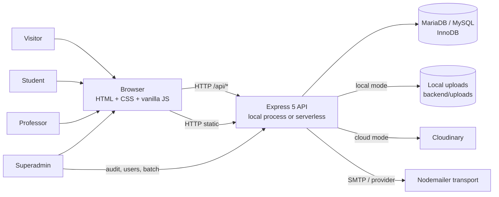

**Trust boundaries:**

- The browser is untrusted. JWT, role, profile, and gamification state are all supplied by the client and must be validated server-side.
- The database is trusted for integrity but not for authorization.
- Local uploads are served directly by Express; there is no separate object-storage authorization layer.
- Email delivery is an external side effect and can fail independently.

---

## 3. Runtime Topology

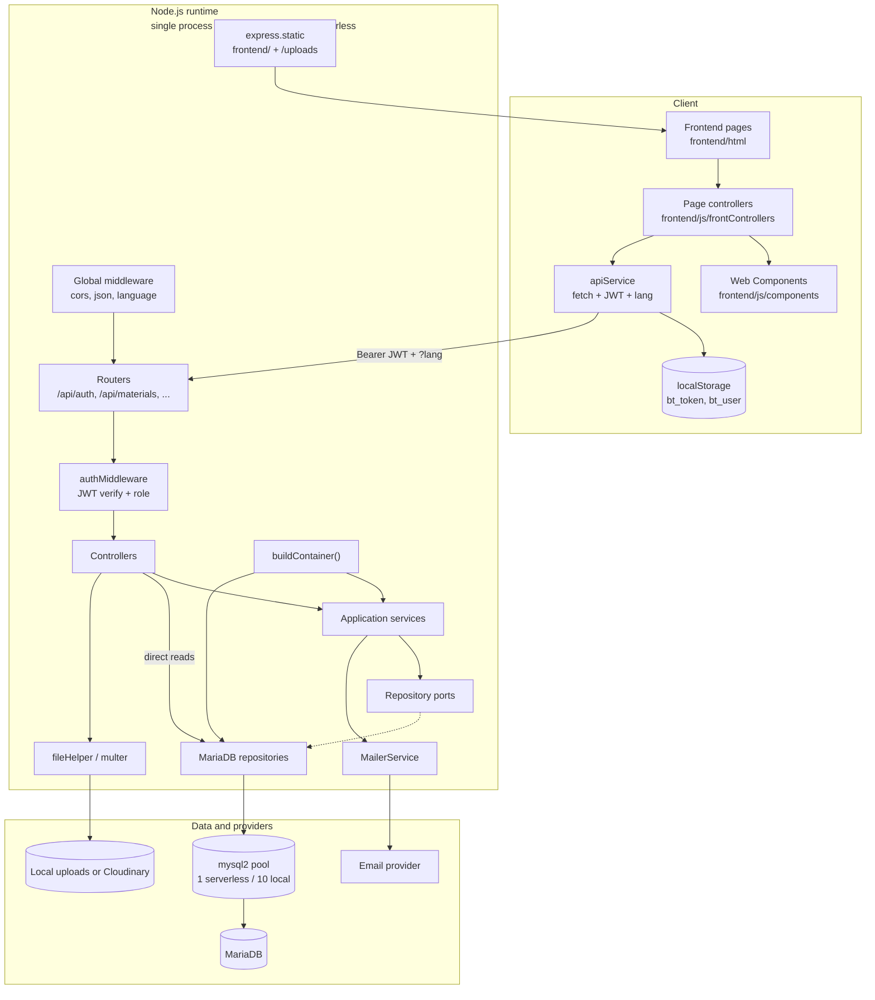

Local development uses **one process for the API and frontend**. Production runs the frontend on Vercel and the API as serverless functions: there is no shared process or pool across instances. The runtime detects `VERCEL`, `AWS_LAMBDA_FUNCTION_NAME`, or `SERVERLESS=true` and defaults to one DB connection per instance with no pool warmup. Configure the database `max_connections` for the maximum number of concurrent functions, not for one process.

---

## 4. Backend Layer Model

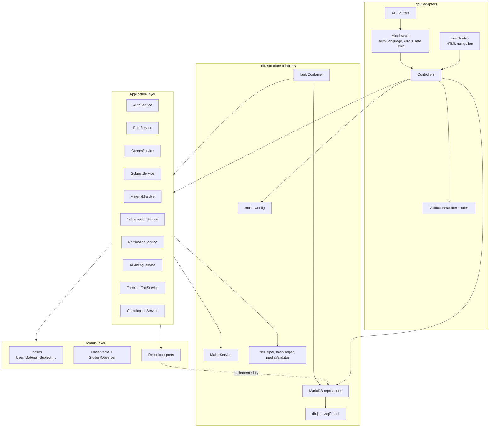

### 4.1 Input adapters

- `backend/routes/*.js` define the HTTP surface. Route order matters for Express matching, especially `/materials/global`, `/materials/mine`, and `/:id`.
- `backend/controllers/*.js` parse request data, call application services, and format responses through `utils/respond.js`; no controller reads repositories directly.
- `backend/middleware/authMiddleware.js` verifies JWTs and enforces coarse role checks.
- `backend/middleware/languageMiddleware.js` resolves a language and exposes `req.t`.
- `backend/validator/*` implements a rule-based validation module with localized messages.

### 4.2 Application services

| Service | Main responsibilities | Notable dependencies |
|---|---|---|
| `AuthService` | Registration, login, verification, password reset/change, ban/unban, professor creation. | User/role repositories, audit, mailer, `LanguageManager`, `hashHelper`. |
| `RoleService` | Role CRUD and audit. | Role repository. |
| `CareerService` | Careers and career years. | Career repository, audit. |
| `SubjectService` | Subject CRUD, professor resolution/assignment, association requests. | Subject/user/career repositories, audit. |
| `MaterialService` | Stable facade used by routes; delegates upload, moderation, association, management, catalog, favorites, and file access. | Material-focused subservices plus repositories, audit, tags, file helper, gamification. |
| `SubscriptionService` | Student subscriptions and professor bans. | Subscription/subject/user repositories, audit. |
| `NotificationService` | Notification inbox and read state. | Notification repository. |
| `AuditLogService` | Best-effort audit writes and reads. | Audit repository. |
| `ThematicTagService` | Tag listing, creation, ban/delete. | Tag repository. |
| `GamificationService` | XP, reads, backlog, progress, streaks, badges, follows, profile. | Gamification/user/material/notification repositories. |

`MaterialService` keeps its public API but is now a thin facade. The implementation lives in `application/services/material/`: `MaterialUploadService`, `MaterialModerationService`, `MaterialAssociationService`, `MaterialManagementService`, `MaterialCatalogService`, `MaterialFavoriteService`, `MaterialAccessService`, and `MaterialServiceContext`. Shared authorization and state rules live in `domain/policies/MaterialPolicy.js`, with regression tests in `backend/tests/materialPolicy.test.js`.

### 4.3 Domain

- Entities are mostly **data holders with mapping/normalization helpers** (`User`, `Material`, `Subject`, etc.).
- `Material.cancelUpload()` is one of the few behavior-bearing domain methods.
- `domain/observers/Observable.js` and `StudentObserver.js` model the Observer pattern, but `StudentObserver.notifications` is an in-memory array and is discarded after the request.
- Repository ports are abstract classes with `_notImplemented` methods. `backend/tests/repositoryPorts.test.js` enforces that every MariaDB adapter implements its port; `npm run test:contract` validates read shapes against a real database.

### 4.4 Infrastructure

- `config/db.js` creates one process-global `mysql2` pool with serverless-aware defaults (`connectionLimit: 1`, `queueLimit: 20`, idle timeout 10s, no warmup) and local defaults (`connectionLimit: 10`, `queueLimit: 50`, `maxIdle: 2`), `utf8mb4`, and optional SSL with `rejectUnauthorized: false`. Connection saturation is normalized to `DATABASE_UNAVAILABLE`/HTTP 503.
- `infrastructure/container.js` manually wires repositories and services. There is no lifecycle, scoping, or transaction manager.
- `config/multerConfig.js` selects local disk or Cloudinary storage and applies MIME/size limits.
- `utils/hashHelper.js` provides SHA-256 hashing for files, strings, and tokens.
- `utils/mediaValidator.js` validates file/link types and cover images.

---

## 5. Request Lifecycle

A typical API request follows this path:

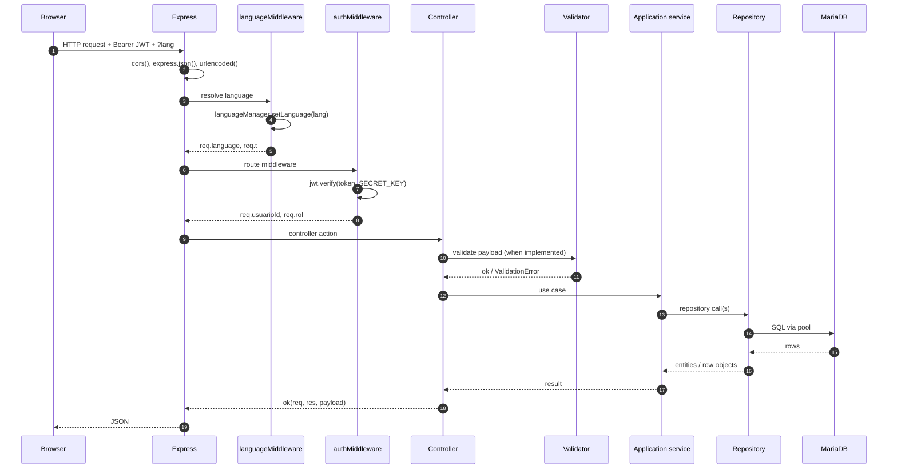

### 5.1 Cross-cutting behavior

- **Language:** query `lang`, then `x-language`, then `Accept-Language`, then `DEFAULT_LANGUAGE`.
- **Errors:** `errorMiddleware` localizes `AppError` and validation errors; pool exhaustion becomes `DATABASE_UNAVAILABLE` (503); unexpected errors become a generic 500.
- **Rate limiting:** only upload routes use an in-memory limiter. Login, registration, password reset, verification, follows, favorites, reads, and comments-like actions are not rate-limited.
- **Static files:** frontend assets are served by Vercel in production. Express only serves public cover images under `/uploads`; material documents go through `/api/materials/:id/file` and `.../download`.
- **File authorization:** approved materials are public; pending materials require the author/uploader, a professor of an associated subject, or a Superadmin. Auth is resolved lazily only when the material is not public.
- **CORS:** `app.use(cors())` allows any origin.

### 5.2 Important lifecycle gaps

1. **Transaction coverage is partial**: `db.transaction` exists and some use cases use it, but many multi-table writes still run as independent repository calls.
2. There is no **unit of work** or transaction manager in the container; repositories do not share a formal context beyond the AsyncLocalStorage connection.
3. There is no **idempotency key** for uploads, follows, favorites, or moderation actions.
4. There is no **API versioning**; the HTTP contract is documented in [`openapi.yaml`](openapi.yaml).

---

## 6. Domain Model and Main Aggregates

The detailed class model is in [`class_diagram.txt`](class_diagram.txt). The main aggregates and relationships are:

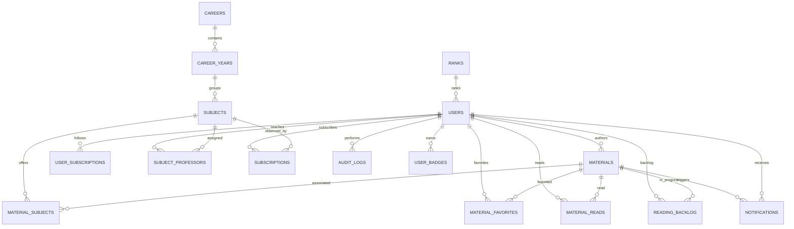

### 6.1 Aggregate boundaries

| Aggregate | Root | Notes |
|---|---|---|
| Identity | `User` | Role, profile, XP, rank, verification/reset tokens. |
| Academic structure | `Career` → `CareerYear` → `Subject` | Subject has a primary professor cache and a many-to-many professor table. |
| Material | `Material` | Has per-subject associations, moderation state, file hash, favorites, reads, backlog, notifications. |
| Subscription | `Subscription` | Student ↔ subject; also used for bans. |
| Gamification | `User` + `ReadingStreak` + `UserBadge` | XP on user; streaks and badges in separate tables. |
| Audit | `AuditLog` | Polymorphic target, no foreign key. |

### 6.2 State duplication

The most important modeling issue is **duplicated state without a single owner**:

- `materials.estado` vs `material_subjects.estado_aprobacion`.
- `subjects.profesor_id` vs `subject_professors`.
- `materials.contador_favoritos` vs `COUNT(material_favorites)`.
- `users.xp` / `users.rank_level` vs the events that produced them.
- `materials.es_favorito` (legacy global flag) vs per-user `material_favorites`.

These caches are useful only if they are derived and reconciled. Today they are updated by independent statements, often outside transactions.

---

## 7. Main Runtime Flows

### 7.1 Authentication and account states

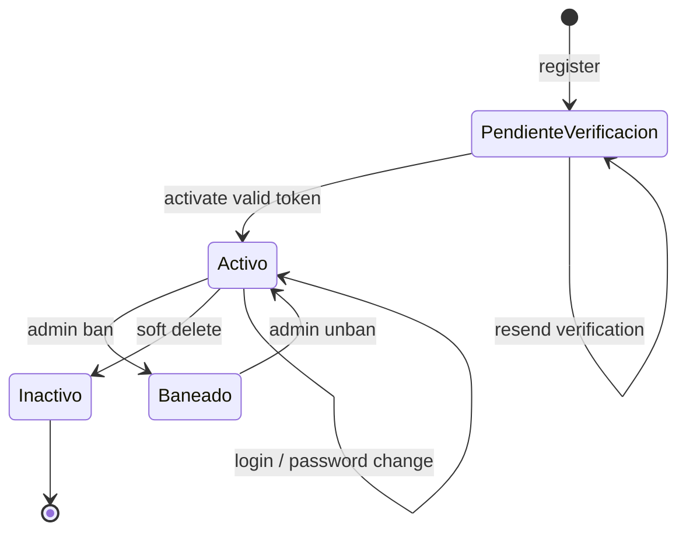

Important properties:

- JWT payload is `{ id, role }`, signed with `JWT_SECRET`, default expiry `2h`.
- Login rejects `PendienteVerificacion`, `Inactivo`, and `Baneado`.
- `verifyToken` only checks the signature; it does not reload the user or check `estado`.
- There is no token version, `jti`, refresh rotation, or revocation list.
- Password reset and password change do not invalidate existing JWTs.
- `EXPOSE_DEV_TOKENS` returns raw verification/reset tokens outside production.

### 7.2 Material upload and moderation

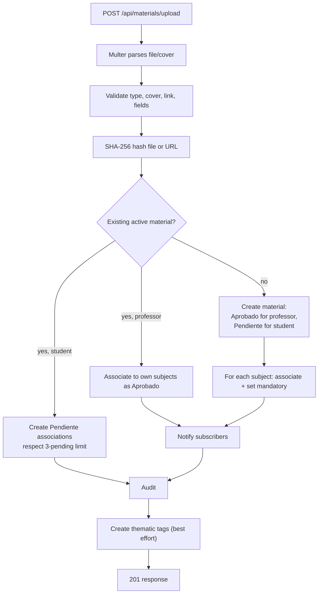

Critical observations:

- A professor-created material is globally `Aprobado` and each association is `Aprobado`.
- A student-created material is globally `Pendiente`; approval of one subject association also sets the global state to `Aprobado`.
- Rejecting the last association of a pending material clears its file fields and sets `Rechazado`.
- Duplicate professor upload associates an existing material but does not change its global state.
- All of these steps are separate autocommit statements.
- File cleanup is handled in the controller, outside the service transaction.

### 7.3 Subscription / Observer

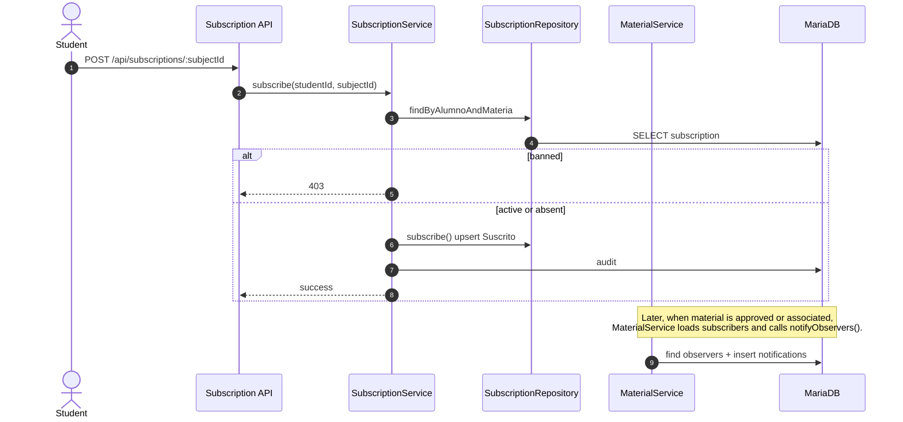

The Observer pattern is **simulated per request**: the subject is loaded, `StudentObserver` instances are created, `update()` pushes into in-memory arrays, and `NotificationRepository.createMany` persists notifications. There is no durable event bus, retry, dead-letter queue, or delivery guarantee for email.

### 7.4 Reading, progress, and gamification

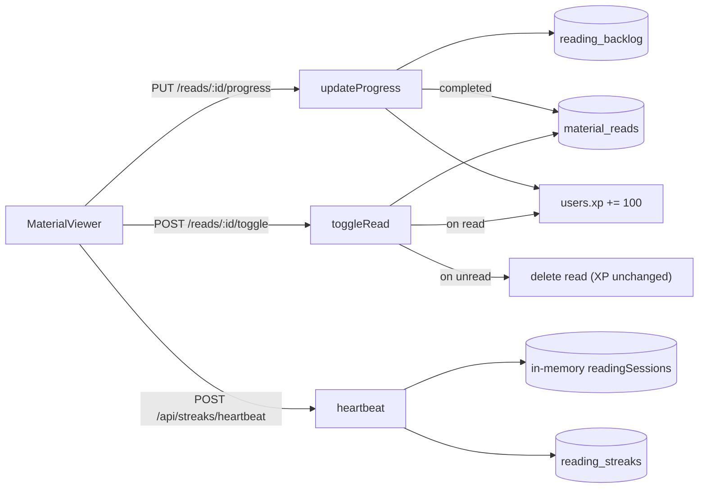

Problems in this flow are covered in `code_analysis.md` and `database_performance.md`:

- progress is client-supplied and can be inflated;
- toggling read/unread farms XP;
- any material can be marked read regardless of visibility;
- heartbeat trusts `activeSeconds` and keeps per-user/material state in process memory;
- streak date logic uses UTC day keys, which may differ from the user's local day.

### 7.5 Audit

`AuditLogService.record()` writes through the outbox with `immediate: true` when an outbox is available, so audit rows are retried and idempotent. Remaining gaps:

- the database user can still mutate `audit_logs` directly; there is no append-only trigger;
- there is no retention/archive policy;
- the list endpoints are paginated and batch target names, but audit is still a normal SQL table.

---

## 8. Frontend Architecture

### 8.1 Page and module model

- `frontend/html/*.html` are static pages with a single `<script type="module" src="/js/bootstrap.js">` entry point.
- `frontend/js/bootstrap.js` imports utilities, components, and page controllers as ES modules in dependency order.
- Modules use explicit `import`/`export`; there are no `globalThis` bridges. `bootstrap.js` is the only application entry point.
- `frontend/js/theme-init.js` remains a minimal classic script in `<head>` to apply the stored theme before first paint.
- `frontend/js/frontControllers/*.js` bind to DOM elements and orchestrate page behavior.
- `frontend/js/components/*` are native Web Components or component factories.
- `frontend/js/services/apiService.js` centralizes fetch, JWT attachment, language propagation, and 401 logout.
- `backend/scripts/checkFrontendModules.js` links and evaluates the module graph in CI.
- `frontend/js/utils/authHelper.js` stores the JWT and user object in `localStorage`.
- `frontend/js/i18n/LanguageManager.js` loads `es`/`en` locales and notifies components.
- `frontend/js/utils/dom.js` (or equivalent) provides `el`, `render`, and safe DOM helpers; the project avoids `innerHTML` in application code.

### 8.2 Rendering and data loading

Most pages load a full collection and then filter/sort/paginate in the browser:

- Catalog: `GET /api/materials/global` returns all approved materials; the controller stores `allMaterials`, filters/sorts client-side, and renders `PAGE_SIZE` items.
- Profile: loads profile, stats, badges, and tab content; some tabs load all uploads/reads/backlog.
- Admin: loads users, audit, subjects, careers, and materials without server pagination.

This is simple and works for small datasets, but it makes first-load cost proportional to total content and prevents efficient caching.

### 8.3 Session and authorization

- `authHelper.getRole()` reads the role from `localStorage`, not from a verified server response.
- Route guards in the frontend are convenience only; backend authorization is authoritative.
- The JWT is sent in the `Authorization` header and is therefore not automatically attached by the browser to cross-site requests, but `localStorage` makes it readable by any XSS.
- `apiService` logs out on any 401 from a non-public endpoint, which is correct for expired/invalid tokens but can also hide authorization bugs during development.

### 8.4 Internationalization

- `LanguageManager` in the frontend is global and client-side.
- API requests append `?lang=...`; the backend resolves the language per request but also mutates a shared `LanguageManager` instance.
- Validation messages are localized on the backend; frontend components also translate labels.

---

## 9. Configuration and Deployment

### 9.1 Configuration sources

- `dotenv` loads `backend/.env` at process start.
- `db.js`, `multerConfig.js`, `AuthService.js`, `authMiddleware.js`, and other modules read `process.env` at module load time.
- `backend/config/env.js` validates required variables, JWT secret strength, origins, booleans, integers and file mode at startup.
- Defaults exist for port, JWT expiry, token lifetimes, language, file mode, and rate limits.

### 9.2 Deployment shape

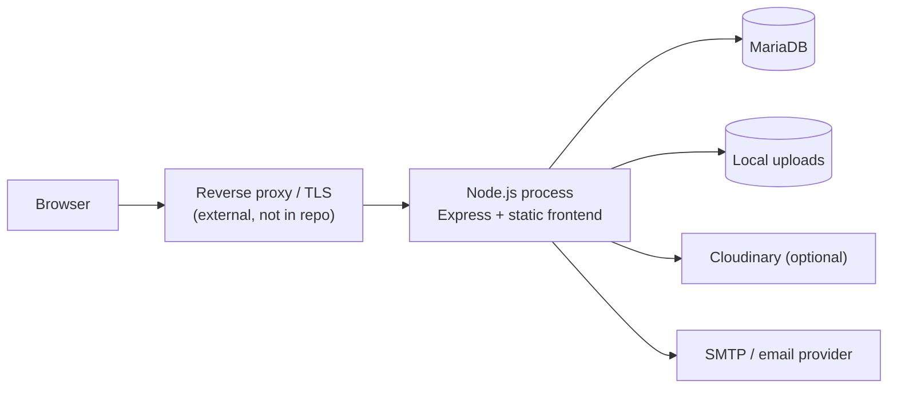

The repository still has no container definition, process manager configuration, migration runner, or backup/restore automation. The process exposes `/healthz`, `/readyz` and optional `/metrics`, and handles graceful shutdown; `npm start` runs `node server.js` directly.

### 9.3 Database bootstrap

- `init.sql` drops and recreates the database, creates the `bibliotech` database user, grants privileges, creates 20 tables, and inserts seed roles/users/categories/ranks.
- `migrate_*.sql` files are custom idempotent scripts using stored procedures to add columns, foreign keys, and indexes.
- `migrations/001_notifications.sql` is a separate one-off migration.
- There is no migration version table, checksum, ordering guarantee, or rollback mechanism.

---

## 10. Architectural Strengths

These should be preserved during refactoring:

1. **Clear separation intent.** The directory structure communicates domain, application, infrastructure, and adapters.
2. **Repository ports.** Application services mostly depend on interfaces rather than concrete SQL.
3. **Central dependency container.** Wiring is explicit and easy to inspect.
4. **Localized validation.** The rule-based validator and `AppError`/`ValidationError` model are a good foundation.
5. **Audit concept.** Every critical action has a named operation, even though durability needs work.
6. **Safe DOM construction.** The frontend avoids `innerHTML` for dynamic content.
7. **Consistent API client.** `apiService` centralizes auth headers, language, and 401 handling.
8. **Existing documentation.** Routes, classes, ER model, and professor sequences are unusually detailed for a project of this size.

---

## 11. Architectural Gaps

| Gap | Consequence | Direction |
|---|---|---|
| Anemic domain model | Business rules live in services and SQL; invariants are duplicated and easy to bypass. | Move state transitions and invariants into entities/domain services; keep services as orchestration. |
| Partial transaction/unit of work | Some multi-table writes still produce partial state, orphan files, or counters that diverge under concurrency. | Extend `TransactionManager`/`UnitOfWork` coverage; keep repositories inside one transaction context. |
| Read DTOs are still thin | Material responses now use `application/dto/materialDto.js`, but other read models still expose repository-shaped data. | Add DTOs/query services per read path. |
| Ports are only partly enforced | Adapter coverage is tested, but return shapes are documented mostly by convention. | Extend contract tests and DTOs to remaining ports. |
| Observer is in-memory | Notifications/emails are not guaranteed; no retry or event history. | Persist domain events or use an outbox + worker. |
| API contract is descriptive | `docs/openapi.yaml` covers every API route and CI validates route coverage and JSON examples, but there is no runtime request/response validation. | Add runtime schema validation if untrusted clients or breaking changes require it. |
| No pagination standard | Unbounded responses; frontend downloads entire datasets. | Standard cursor/page contract; enforce max page size. |
| No caching/read models | Expensive joins and counts on every request. | Cache-aside for reference data; summary tables for counters; CDN for public catalog later. |
| Config at module load | Tests and runtime changes are hard; missing env vars fail late. | Central config module with schema validation, injected into services. |
| Observability is basic | Logs, request IDs, and metrics exist, but there is no tracing or slow-query dashboard. | Add OpenTelemetry tracing and DB slow-query metrics. |
| Serverless pool fan-out | Each active function instance opens its own DB connection; batch traffic can exhaust `max_connections`. | Keep one connection per instance, short idle timeout, bounded queue with 503 backpressure, or add a DB proxy/pooler. |
| No job/queue boundary | Hashing, email, notifications, and badge evaluation run in request path. | Offload to background jobs when latency matters. |

---

## 12. Target Architecture

The target should preserve the current modular monolith and improve boundaries rather than jump to microservices.

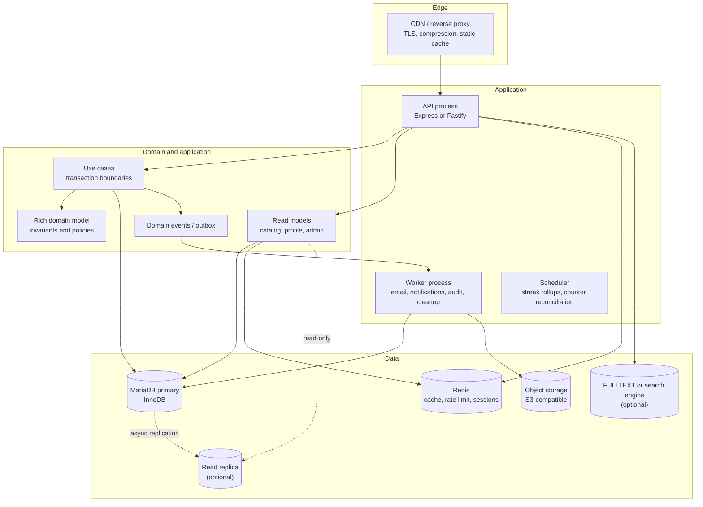

### 12.1 Recommended patterns

| Pattern | Where | Why |
|---|---|---|
| Unit of Work / transaction manager | Application services | Atomic multi-table writes and rollback. |
| Domain events + outbox | Material approval, subscription, ban, read completion | Durable notifications, audit, email, and badge evaluation. |
| Policy objects | Material authorization, visibility, moderation | Replace scattered role/ownership checks with testable rules. |
| Query objects / read models | Catalog, profile, admin, audit | Move complex SQL out of controllers and avoid entity hydration for reads. |
| Cursor pagination | Catalog, audit, notifications, reads | Stable and efficient at scale. |
| Cache-aside | Careers, subjects, categories, ranks, public catalog | Reduce repeated reference-data queries. |
| Idempotency keys | Upload, favorite, follow, moderation | Safe retries and duplicate prevention. |
| Rate limiting | Auth, uploads, engagement writes | Abuse prevention beyond uploads. |
| Circuit breaker / retry | Email, Cloudinary | Isolate provider failures. |
| Structured logging + request ID | All requests and jobs | Traceability and faster incident response. |
| Health/readiness | Process and dependencies | Safe orchestration and deploys. |

### 12.2 Migration principles

1. **Do not rewrite the UI or the stack.** Improve boundaries incrementally.
2. **Introduce transactions first**, starting with material upload, batch upload, subject assignment, and registration.
3. **Make state ownership explicit** before adding caches or counters.
4. **Add indexes and query rewrites** before introducing replicas or search engines.
5. **Measure with `EXPLAIN` and real data** before and after each database change.
6. **Keep the existing route contract** while adding pagination and validation in a backward-compatible way.
7. **Document behavior changes** (for example, banning invalidates tokens) in release notes.

---

## 13. Architecture Decision Records

Implemented ADRs live in [`adr/`](adr/README.md):

- [0001](adr/0001-material-service-decomposition.md): `MaterialService` facade with focused services.
- [0002](adr/0002-frontend-es-modules.md): native ES modules without a build step.
- [0003](adr/0003-api-contract-and-ci.md): OpenAPI, DTOs, contracts, and CI gates.
- [0004](adr/0004-state-model.md): material state and frontend-local UI state.
- [0005](adr/0005-auth-session.md): JWT lifecycle and the HttpOnly file cookie.
- [0006](adr/0006-transactions.md): per-use-case transactions with `AsyncLocalStorage`.
- [0007](adr/0007-search.md): MariaDB FULLTEXT before an external engine.
- [0008](adr/0008-storage.md): local disk or Cloudinary.
- [0009](adr/0009-audit.md): outbox-backed audit with append-only intent.
- [0010](adr/0010-extraction.md): no extraction of search/media/notifications without measured bottlenecks.

Still intentionally undocumented as ADRs: modular-monolith-vs-services (the
monolith is the accepted baseline), configuration/secret management, database
migration rollback, and observability/SLOs.
